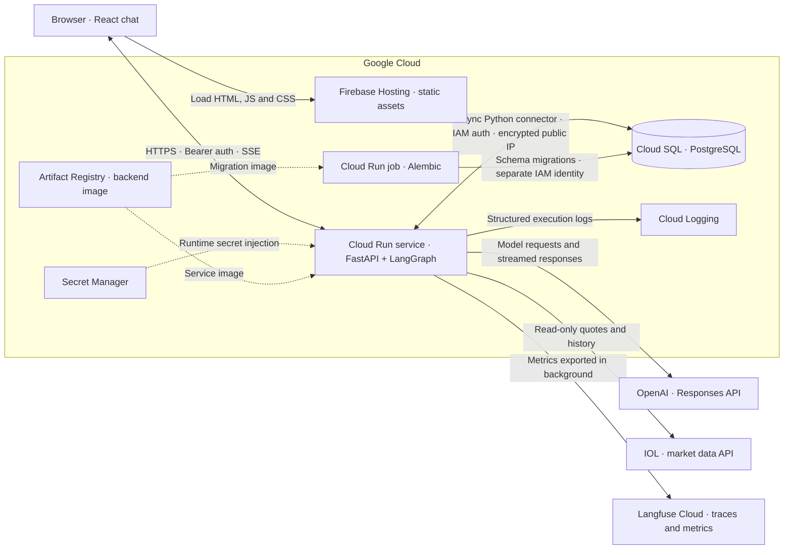
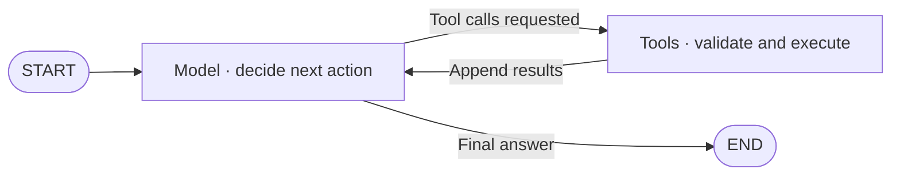
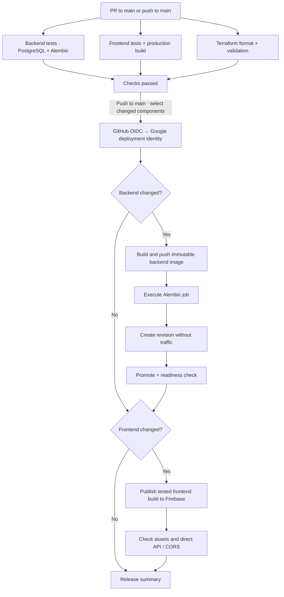

# AI Finance Chatbot on Google Cloud

An end-to-end AI finance chatbot combining asynchronous Python, tool-driven agent workflows, and infrastructure as code on Google Cloud. The project covers application development, database migrations, cloud provisioning, automated releases, and privacy-conscious LLM observability.

The assistant answers personal-finance questions, retrieves Argentine market data through IOL, and creates interactive historical-price charts. Responses stream to a React interface alongside live tool activity. Each user has a persistent private conversation, and new accounts require administrator approval before accessing the assistant.

| Layer | Technologies |
| --- | --- |
| Backend | Python 3.13, FastAPI, Uvicorn, async SQLAlchemy, asyncpg |
| Agent | LangGraph, OpenAI Responses API, JSON Schema tool contracts, structured XML prompt |
| Market data and presentation | IOL API, server-validated chart data, Recharts, streamed Markdown |
| Frontend | React, TypeScript, Vite, Tailwind CSS |
| Persistence | PostgreSQL 17, Alembic, PostgreSQL advisory locks |
| Infrastructure | Terraform, Cloud Run, Cloud SQL, Artifact Registry, Secret Manager, Firebase Hosting |
| Delivery and observability | Docker Compose, GitHub Actions, OIDC / Workload Identity Federation, Cloud Logging, Langfuse |

## System architecture



Firebase Hosting delivers the compiled frontend. Once loaded, the browser calls Cloud Run directly for authentication, history, and streamed chat responses. The production API URL is a public frontend build input, and FastAPI validates the application session on protected endpoints.

Locally, Docker Compose runs three services: a Vite development server, the Python backend, and PostgreSQL. The browser uses Vite's `/v1` proxy to reach the backend. Production uses Firebase for static hosting and Cloud Run for the API, with exact-origin CORS.

## Backend architecture

### Hexagonal boundaries

The backend separates application decisions from external integrations using ports and adapters.

| Component | Responsibility |
| --- | --- |
| `domain/` | Provider-independent messages, turns, events, errors, and market-data values |
| `application/` | Authentication, turn orchestration, dependency contracts, and tool execution rules |
| `adapters/inbound/http/` | FastAPI routes, request/response validation, authentication transport, and SSE framing |
| `adapters/outbound/` | PostgreSQL, OpenAI, IOL, LangGraph execution, rate limiting, and Langfuse implementations |
| `prompts/` | Packaged finance instructions, prompt validation, and profile-context construction |
| `app.py` | Composition root and shared resource lifecycle |

Ports describe what the application needs through Python `Protocol` interfaces. Concrete adapters explicitly declare the protocol they implement, making the dependency visible where the class is defined.

```python
class LangGraphAgent(AgentRunner):
    ...

class PostgresConversationRepository(ConversationRepository):
    ...

class LangfuseTracing(TurnTracing):
    ...
```

`app.py` constructs the adapters once during FastAPI startup and injects them into the application. The turn orchestrator coordinates persistence, admission limits, conversation locks, agent execution, and cleanup through its ports. That boundary allows tests to substitute controlled implementations for database, model, and telemetry dependencies.

### Async execution and concurrency

Each backend container runs one Uvicorn worker with one event loop. The process shares its orchestrator, compiled graph, clients, and connection pools across requests. Each chat invocation owns its history, graph state, pending tool calls, and chart references.

Model requests, IOL requests, and PostgreSQL operations use async clients. While a request awaits network I/O, the event loop can advance other requests. Password hashing runs in a bounded worker-thread path because it is CPU-intensive. Synchronous telemetry shutdown also runs off the event loop.

Two limits apply at different levels. Cloud Run accepts up to eight concurrent HTTP requests per instance, while the application admits up to four active chat turns per process by default. Authentication, history, and health requests also use HTTP capacity. The application rejects excess chat turns promptly, and a shared PostgreSQL advisory lock prevents overlapping turns for the same user across tabs, processes, or deployment revisions.

A turn follows this sequence.

1. Validate the session, origin, request body, and per-user rate limit.
2. Admit the turn, acquire its conversation lock, and persist the user message.
3. Load the complete conversation history and start the graph with invocation-local state.
4. Stream model text, tool activity, and chart blocks as execution progresses.
5. Save the final assistant message, presentation blocks, provider transcript, and execution metadata.
6. Close the turn observation and release the lock and active-turn slot, including on failure or cancellation.

### LangGraph and the ReAct-style tool loop

One compiled graph drives repeated model and tool rounds.



The backend sends the model the registered tool names, descriptions, and JSON Schemas. OpenAI function calling returns a tool name and arguments. The graph validates that request, executes the async handler, and returns the result to the model. The model can request more tools before completing its response.

Multiple tools can run within one turn, including repeated calls to the same tool. Handlers execute sequentially, with separate budgets for model calls, tool calls, graph recursion, and elapsed time. Model selection and reasoning effort are configuration values, currently `openai:gpt-6.1-terra` and `high` for the deployed environment. An offline simulated model supports local transport and persistence checks.

Successful turns preserve the provider transcript needed to reconstruct subsequent model context. Loading that transcript preserves tool-call relationships while replaying saved history. Every saved conversation message is included in later turns, so context size and token consumption grow with the conversation.

### Market tools and chart generation

| Tool | Purpose |
| --- | --- |
| `search_instruments` | Resolve instrument names and symbols against the IOL catalog |
| `get_quote` | Retrieve a quote with available currency, market, settlement, and timestamp information |
| `get_price_history` | Retrieve bounded daily history and return a validated series reference |
| `show_chart` | Build an absolute-price or base-100 chart from series retrieved during the current turn |

The IOL adapter handles broker authentication, serialized token renewal, bounded caches, HTTP deadlines, and response normalization. Market access covers Argentine instruments available to the configured account, including local shares, CEDEARs, and bonds. Actual access and coverage depend on IOL account permissions.

Chart points come from backend-owned market series. The model requests a chart using series references, and the application emits a typed chart block for React to render. The assistant can choose to show a chart when it helps explain a historical comparison. Completed messages persist their ordered text and chart blocks as snapshots, allowing history to display the same result after a reload.

Histories contain unadjusted prices. A conservative comparability check rejects a halving or twofold increase between consecutive observations before generating a chart or period summary. That check can flag genuine extreme moves and cannot detect every corporate action. Base-100 comparisons describe relative prices and exclude coupons, dividends, and currency conversion.

See the [market tools guide](doc/market-tools.md) for provider behavior, limits, and manual review examples.

### Structured prompt and execution controls

The finance prompt is packaged in [`finance.xml`](backend/src/chatbot/prompts/finance.xml), validated at startup, and identified in execution metadata by its content hash. XML sections define the role, financial scope, instructions, rules, output format, and examples.

The instructions cover financial topic boundaries, source-backed market facts, ambiguous instruments, chart usage, and treating conversation/profile/tool content as reference data. The model receives the user's display name and a runtime date alongside its instructions and history.

Application checks enforce the tool registry, argument schemas, ownership, chart-reference scope, and resource budgets. These checks complement the prompt's behavioral guardrails.

| Default control | Value |
| --- | --- |
| Active chat turns per process | 4 |
| Chat submissions per user | 20 per rolling minute |
| Total turn deadline | 240 seconds |
| Deadline per model call | 120 seconds |
| Deadline per tool execution | 10 seconds |
| Model calls per turn | 4 |
| Tool calls per turn | 8 |
| Graph recursion limit | 12 |
| Maximum output tokens per model call | 8,192 |

The OpenAI SDK has automatic retries disabled, so the application controls the execution budget. Partial streamed answers remain visibly incomplete and the database records the failed or cancelled turn. Completed assistant messages become canonical history after persistence succeeds.

### Authentication and conversation ownership

Users register with a display name, username, and password. FastAPI verifies Argon2id hashes and issues opaque Bearer session tokens. PostgreSQL stores a verifier for each token, with a default 24-hour absolute expiry. Logout revokes the current session, and blocking a user revokes their sessions.

New registrations start blocked. An approved administrator can approve or block users through a minimal dashboard. Initial administrator promotion is an explicit database operation documented in the [user approval guide](doc/user-approval.md).

The backend derives conversation ownership from the authenticated identity. Session and account validity are checked during active generation, and losing access or coordination stops the execution. The browser stores its token in per-tab `sessionStorage`.

## Google Cloud infrastructure and delivery

### Terraform layout and state

Infrastructure lives in two independently applied Terraform roots.

```text
infra/
├── bootstrap/                  # Create and protect the Terraform state bucket
└── environments/
    └── production/             # Application resources, IAM, and runtime configuration
```

The bootstrap root creates a private Cloud Storage bucket with object versioning and deletion protection in Terraform. After bootstrap, both roots use that bucket with separate state prefixes, `bootstrap` and `environments/production`. Remote state allows later Terraform operations to reconcile the same resources, while backend locking coordinates state updates.

The production root groups resources by responsibility, including `cloud_run.tf`, `cloud_sql.tf`, `migrations.tf`, `registry.tf`, `secrets.tf`, `iam.tf`, `firebase.tf`, and `github_actions.tf`. It enables the required service APIs and declares the application infrastructure in the existing Google Cloud project.

### Compute, storage, and identities

| Resource | Current configuration and purpose |
| --- | --- |
| Cloud Run service | FastAPI backend in `us-central1`, second-generation execution, 1 vCPU, 512 MiB RAM, request-based billing, startup CPU boost |
| Cloud Run scaling | Minimum zero and service-level maximum one instance, eight concurrent requests, 270-second request timeout |
| Cloud SQL | PostgreSQL 17 Enterprise, `db-g1-small`, single zone, 10 GiB SSD, fixed storage allocation |
| Artifact Registry | Regional Docker repository for backend images used by both the API and migration job |
| Secret Manager | Versioned OpenAI, IOL, and Langfuse secrets injected into the backend |
| Firebase Hosting | Static React assets, SPA routing, and cache policy |
| Cloud Run job | Explicit Alembic execution using a separate migration identity |
| Service accounts | Separate runtime, migration, and deployment identities with scoped permissions |
| Workload Identity Federation | Short-lived GitHub OIDC access to the deployment identity |

Cloud Run can scale to zero during inactivity and start again on the next request. That introduces cold-start latency. Cloud SQL remains active independently of backend traffic. The deployed database has deletion protection enabled; automatic backups and point-in-time recovery are currently disabled.

### Passwordless database connections

Local Compose uses `DATABASE_MODE=direct` with asyncpg against its PostgreSQL service. Cloud Run and the migration job use `DATABASE_MODE=cloud_sql` with the async Cloud SQL Python Connector.

The cloud connector uses encrypted public-IP connections and automatic IAM database authentication under the attached service account. The instance requires a connector and has no authorized direct-access networks configured. Runtime and migration identities each have their own PostgreSQL IAM user.

Google Cloud IAM permissions authorize connection and authentication. PostgreSQL grants separately authorize operations on schemas, tables, and sequences. The migration identity creates and upgrades the schema; the runtime identity receives the data access needed by the API. An explicit bootstrap helper configures these grants through an authorized administrator.

SQLAlchemy uses bounded pools for ordinary database work and dedicated advisory-lock connections. Lazy connector refresh suits request-based Cloud Run execution. Alembic reuses the connection factory with its migration settings.

See the [database IAM setup guide](doc/database-iam-setup.md) for the initialization sequence.

### Configuration and secrets

Terraform declares the secret containers, access grants, version references, and ordinary Cloud Run environment values. The operator adds secret payloads to Secret Manager outside Terraform, keeping those values out of Terraform state. Numeric version references make the injected secret version explicit.

OpenAI and IOL credentials and the Langfuse secret key belong to the runtime backend. The Langfuse public key and base URL are ordinary configuration. The deployment identity publishes artifacts and updates the permitted service/job resources using short-lived federated credentials.

The included project IDs, resource names, Firebase site, and OIDC repository/owner IDs describe the current deployment. Deploying a separate copy requires updating those identifiers, Terraform backend locations, and workflow configuration for the target project and repository.

### GitHub Actions release flow



Pull requests targeting `main` run backend tests against a PostgreSQL 17 service, frontend tests and a production build, and Terraform format/schema checks. Terraform validation runs without cloud credentials or remote-state access. Model and market-provider tests use controlled fixtures.

Pushes to `main` deploy changed application components after checks pass. Backend changes build a Linux AMD64 image and push it to Artifact Registry. The release uses an immutable image digest for both the migration job and the service. Alembic upgrades the database first, then the workflow creates a backend revision without traffic, verifies the candidate, promotes it, and checks readiness.

If promotion or readiness fails, the script attempts to restore traffic to the previous revision when the candidate still owns traffic. Schema downgrades and frontend release recovery require operator review. Migration changes therefore need compatibility with the previous application revision.

Frontend changes publish the exact build artifact tested by that workflow run, followed by asset and API/CORS checks. A manual workflow dispatch selects both application components. Documentation-only changes run checks and skip application publication.

OIDC trust is restricted to the configured numeric repository and owner IDs, the `main` branch, the deployment workflow path, and the permitted trigger types. Terraform manages resource configuration, and the release workflow manages image versions and explicit service traffic. Infrastructure changes are reviewed and applied separately.

See the [GitHub Actions guide](doc/github-actions.md) for setup, permissions, and release verification.

## Observability and privacy

Cloud Logging receives structured execution records with safe identifiers, status, durations, model/tool call counts, and reported token usage. Health endpoints distinguish process liveness from database/schema readiness.

Langfuse exports one `chat-turn` trace per started turn, with child observations for each model call and registered tool execution.

| Observation | Recorded data |
| --- | --- |
| Turn | Request/turn IDs, environment, elapsed time, time to first text, final status, and token totals |
| Model call | Model, reasoning effort, duration, time to first text when available, and reported input/output token counts |
| Tool call | Registered tool name, duration, and completion/failure/cancellation status |

Telemetry uses an explicit field allowlist. User messages, assistant responses, history, prompts, tool arguments/results, names, emails, and credentials stay outside the Langfuse export. Missing token usage remains unknown, with incomplete totals marked accordingly. Prompt content still follows the application's normal model request flow to OpenAI.

The SDK batches exports in the background, and the backend attempts bounded cleanup at shutdown. Request-based Cloud Run can throttle CPU outside requests, so queued observations may be delayed or lost. Production traces use the `production` environment; local traces use `local`.

## Run locally

### Requirements and external integrations

Install Docker with Compose, Make, and Python 3 for the configuration and CLI helpers. Backend dependencies and frontend build tools run inside the application containers.

| Integration | What you need |
| --- | --- |
| Offline local mode | Docker services and the default simulated model |
| OpenAI | An API project with available credits/quota and access to the configured model |
| IOL | Broker credentials with API access to the required market-data endpoints |
| Langfuse | A project, its public/secret key pair, and the project's regional base URL |
| Google Cloud deployment | A billed project, Terraform, Google Cloud CLI, and Firebase CLI for operator setup |

IOL and Langfuse can be configured independently. Local development uses the Compose database and its own chat accounts.

### Start the application

```sh
make env
# Edit backend/.env to enable the integrations you want.
make start
make health
```

Open [localhost:5173](http://localhost:5173). Register a user and follow the [first administrator setup](doc/user-approval.md) to approve access. The API is available at [localhost:8088](http://localhost:8088), with interactive documentation at [localhost:8088/docs](http://localhost:8088/docs).

`make start` builds the images, starts PostgreSQL, applies Alembic migrations, seeds optional development identities, and starts the backend and frontend. The database volume preserves data across normal restarts. Tests create isolated databases inside that PostgreSQL service.

### Environment files

Compose receives `backend/.env` and `frontend/.env` explicitly. Examples are tracked in the repository; actual `.env` files are ignored.

The backend's optional external-service configuration follows this shape.

```dotenv
MODEL=openai:gpt-6.1-terra
MODEL_REASONING_EFFORT=high
OPENAI_API_KEY=<your-openai-api-key>

MARKET_DATA_PROVIDER=iol
IOL_CREDENTIALS='{"username":"<iol-username>","password":"<iol-password>"}'

LANGFUSE_PUBLIC_KEY=<your-langfuse-public-key>
LANGFUSE_SECRET_KEY=<your-langfuse-secret-key>
LANGFUSE_BASE_URL=https://us.cloud.langfuse.com
```

Use the base URL shown by the Langfuse project. Single-quote the IOL JSON in the env file to preserve special characters in credentials. The complete backend defaults, including database, port, auth, and execution settings, are in [`backend/.env.example`](backend/.env.example). `MODEL=simulated` and `MARKET_DATA_PROVIDER=disabled` support offline development; Langfuse exports activate when all three Langfuse values are supplied.

The frontend needs public build/development values.

```dotenv
FRONTEND_PORT=5173
VITE_API_BASE_URL=
```

An empty `VITE_API_BASE_URL` uses Vite's local proxy. Production builds set it to the Cloud Run HTTPS origin. The backend's `APP_ORIGIN` must match the browser's exact origin, including its local port. Rebuild/restart the relevant containers after changing environment values.

### Commands and tests

| Command | Action |
| --- | --- |
| `make start` | Build, migrate, seed, and start the local stack |
| `make build` | Build the application images |
| `make stop` | Stop the stack and retain the database volume |
| `make status` / `make logs` | Inspect services or follow their logs |
| `make migrate` | Upgrade the local schema explicitly |
| `make test` | Run backend/frontend tests and the frontend production build |
| `make backend-test` / `make frontend-test` | Run one component's tests |
| `make frontend-build` | Typecheck and build frontend assets |
| `make login` / `make logout` | Manage a separate CLI session |
| `make chat MESSAGE='Compare AL30 and GD30 over the last month'` | Stream a chat turn through the CLI |
| `make history` | Read the CLI user's saved conversation |

Tests cover authentication and ownership, real PostgreSQL locks and migrations, model streaming, repeated tools, chart snapshots, cancellation, telemetry privacy, and deployment helpers with mocked cloud commands. Health checks and automated provider tests use offline fixtures; live provider access is exercised through explicit chat requests.

## Frontend and streamed presentation

The React and TypeScript frontend uses Tailwind for authentication, the chat, and the administrator dashboard. A single streamed POST response carries `started`, `delta`, `tool_status`, `chart`, and terminal `completed` or `error` events. A successful HTTP status alone does not establish that the turn completed.

The UI incrementally renders Markdown and structured chart blocks. Live tool activity appears in a collapsible panel with progress indicators between model/tool rounds. The composer is disabled while a turn runs. Reloading restores persisted messages and chart snapshots. Markdown supports lists, tables, emphasis, and code blocks, with escaped user text and restricted HTML/image rendering.

Vite produces static assets for Firebase Hosting. Production auth/history/SSE requests go directly from the browser to Cloud Run. The static hosting path and API stream have separate caching policies; private API responses use `Cache-Control: no-store`.

See the [direct API guide](doc/direct-api.md) for the frontend/backend connection setup.

## Specification-driven development

The project uses specification-driven development (SDD) to define decisions, contracts, limits, and acceptance criteria before implementing each iteration. [`doc/definitions.md`](doc/definitions.md) records project-wide decisions, and `specs/` captures the scope of individual deliveries. Specifications evolve as implementation and operational testing clarify the design.

| Iteration | Scope |
| --- | --- |
| [01 — Backend setup](specs/01-initial-backend-setup.md) | FastAPI, ports/adapters, PostgreSQL, Alembic, Compose, streaming, and coordination |
| [02 — OpenAI finance agent](specs/02-openai-finance-agent.md) | Async model adapter, LangGraph execution, prompt, usage, and execution budgets |
| [03 — Users and chat UI](specs/03-users-and-chat-ui.md) | Registration, sessions, ownership, and the React interface |
| [04 — Google Cloud backend](specs/04-guided-google-cloud-deployment.md) | Terraform bootstrap, IAM, Cloud SQL, migrations, and Cloud Run |
| [05 — Firebase Hosting](specs/05-firebase-hosting.md) | Static frontend publication and browser integration |
| [06 — GitHub Actions](specs/06-github-actions.md) | Tests, OIDC authentication, automated releases, and backend traffic rollback |
| [07 — Market tools and charts](specs/07-market-tools-and-charts.md) | IOL integration, tool iterations, interactive charts, and live activity |
| [08 — Langfuse observability](specs/08-langfuse-observability.md) | Per-turn/model/tool metrics and privacy-aware trace export |

Operational guides in `doc/` cover [request flow](doc/request-flow.md), [database initialization](doc/database-iam-setup.md), [account approval](doc/user-approval.md), [market data](doc/market-tools.md), and [deployment](doc/github-actions.md).

## Current operating boundaries

The deployed environment is `production`. Staging is a future extension using separate configuration, state, data, and secrets. The current footprint favors a single backend instance and a single-zone database.

Chat and authentication rate limits are process-local and reset on restart. Conversation locks use PostgreSQL and remain shared across overlapping deployment revisions. Full history is retained in model context, and a hard process crash can leave an in-progress turn requiring review. Automatic request deduplication, database recovery workflows, and image-retention cleanup are outside the current implementation.
